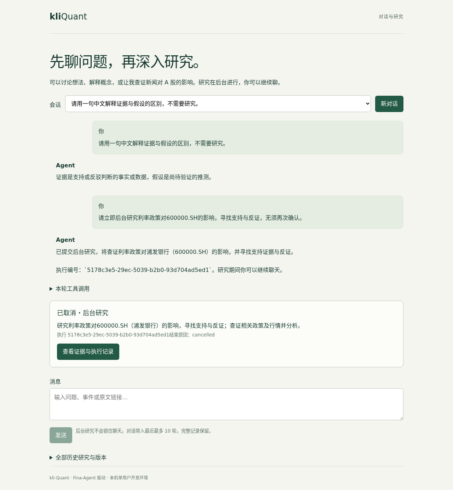

# kli-Quant

基于 [Fina-Agent](https://github.com/klaus-zzz/Fina-Agent) / Deep Agents 的独立量化研究应用。
以持续对话为主入口；A 股事件多跳研究是 Agent 按需调用的后台工具。
提供固定 Tushare 日线、计算与条件性观察校验，研究运行时可以继续聊天、查看进度或取消。
这是新项目，不复制 OmniQuant 部署或用户数据，也不宣称收益或效果更优。



## 仓库分工

- 本仓库 `frontend/`：对话界面，后台研究卡片、固定证据、产物和历史版本。
- 本仓库 `src/kli_quant/`：行情工具、金融计算/结论校验和 HTTP CLI。
- Fina-Agent：通用 HTTP API、Worker、Deep Agents、沙箱、预算、归档与执行版本。
- 模板配置和 Prompt 统一维护在 **Fina-Agent/.fina-agent/**，由 Agent 实例挂载；
  本仓库不复制配置目录，也不持有前端可访问的数据源或模型凭据。

## 开发运行

Python 3.13、uv、Node 24 和 Fina-Agent 0.2.x；仓库相邻放置：

```text
workspace/
  Fina-Agent/              # 根目录 Python 工程、.fina-agent/、.env
  kli-Quant/
    frontend/
    src/kli_quant/
```

底座尚未合入主分支时，检出本项目 CI 固定的底座提交。
按 Fina-Agent README 配置根目录 `.env`，使用开发 PG、S3 bucket、CubeSandbox 和模型，
TUSHARE_TOKEN 也由该后端凭据文件提供。不要给 CLI 或前端复制凭据。

```bash
# 确认 Fina-Agent/.env 指向开发数据库后，在本仓库运行：
uv sync --locked
docker compose build agent-dev
docker compose run --rm agent-dev uv run --no-sync alembic upgrade head
docker compose up -d
```

本项目 Compose 继承 Fina-Agent 的通用 Agent dev 服务，负责安装金融应用包并启动前端。
配置和凭据仍只读挂载自 Fina-Agent；不要同时启动底座仓库的另一份 dev 服务。
工作台 <http://127.0.0.1:5173>，默认经 docker 网络访问 `kli-quant-dev-agent-dev-1:8000`。
若修改底座 Compose 项目名，设置 AGENT_PROXY_TARGET 为对应实例 HTTP 地址；
工作台本机端口可通过 QUANT_UI_PORT 修改。停止工作台用 `docker compose down`。

底座的 `.fina-agent/config.yaml` 选择 `application: kli-quant` 及 `sandbox.template_id`。
对话身份在底座 `.fina-agent/prompts/CHAT.md` 修改；
研究方法在底座 `.fina-agent/prompts/AGENTS.md` 修改。修改后重启底座 API/Worker，
旧执行保留创建时的提示词和模板。配置完整不代表真实服务已经连通。

CLI 可独立通过 HTTP 调用：

```bash
uv run kli-quant research '核实某事件对公司的影响，主动查找反证；证据不足时明确说明'
uv run kli-quant research '新增待核实材料' --topic <research_id> --url https://example.com/source
uv run kli-quant status <run_id>
```

默认 API 为 http://127.0.0.1:8000；可在子命令前传 `--server` 指定其他实例地址。

## 对话与后台研究

普通问题直接回复，明确要求查证新闻或事件时调用 `research_a_share_event`。
调度工具立即返回任务编号；Worker 执行原有多跳查证、固定行情和沙箱链路。
完成结论自动显示在任务卡片中，可展开证据与产物；允许证据不足或没有机会。
会话、消息、任务与版本保存在后端，刷新后可恢复；新增材料通过研究主题编号复核。
每会话同时最多一轮研究；旧工作台记录仍可在“全部历史研究与版本”查看。
目前回复整段返回，对话带入最近最多 10 轮和 5 个任务摘要，受字符预算裁剪；
完整历史保留，但不承诺无限记忆。网络失败重试原消息复用编号，不重复启动研究。

## 金融边界

- 当前支持 A 股 daily / 1d / none；一次最多三只证券、一年区间。
- 价格保留十进制文本，成交量为手，成交额为千元；缺失值不补零。
- 排除截止点当天未完成日线。历史行情标记 historical_reconstruction，不宣称点时数据。
- 正式 signal 产物由后端重算 close_return，验证日期、单位、币种、口径和引用。
- 金融结果的 conditions、signal_usable 和 evaluation_not_before 由本应用提供；评估时间不得早于实际发布。
- backtest 仅是带基准的区间收益比较，尚不是含费用、滑点的策略回测。
- observation 要求正反查证、可确定时间的支持证据、条件和 validated signal 产物。
- 允许 insufficient_evidence 或 no_opportunity，不编造机会。
- 新材料创建新执行并保留旧结论；细粒度判断依赖和自动监控尚未实现。
- 不做自动交易、复杂选股或多 Agent；金融校验规则变更需要升级应用版本。

## 验证

```bash
uv run ruff check .
uv run ruff format --check .
uv run pytest -m 'not integration'
npm --prefix frontend ci
npm --prefix frontend run build
```

离线测试不调用真实服务。集成测试仅使用 FINA_TEST_DATABASE_URL 专用库。
隔离容器中安装本应用和底座，工作目录设为 Fina-Agent 根目录以读取后端 `.env`：

```bash
FINA_LIVE_SERVICES=1 python -m pytest /app/kli-Quant/tests/test_live_services.py -s
FINA_LIVE_AGENT=1 python -m pytest /app/kli-Quant/tests/test_live_agent.py -s
```

真实测试需要现有已授权服务额度；结束后清理自身沙箱、S3 对象和数据库记录。
代码采用 Apache-2.0；数据服务许可独立于代码许可。
